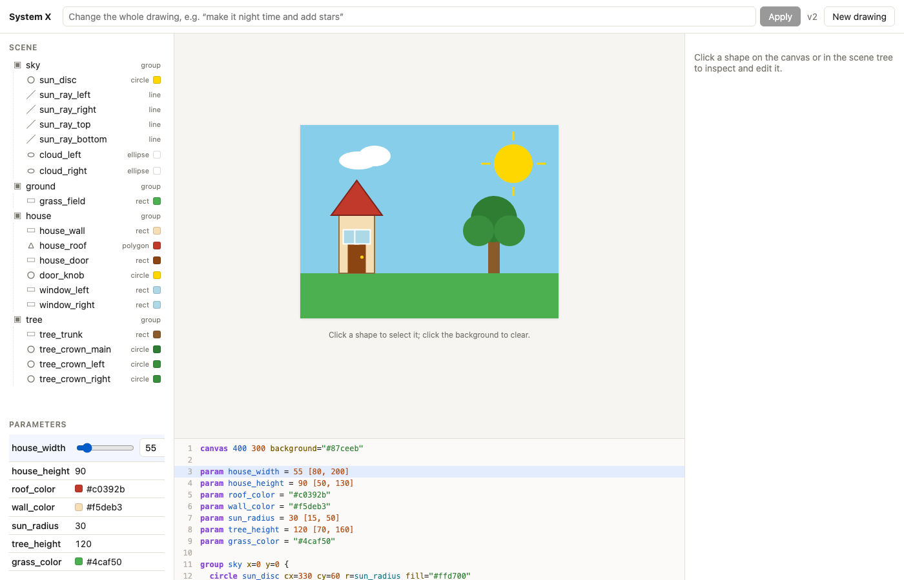

# System X — shape studio

Built from `design.json` (Human-AI grammar design "System X"). You describe a picture. A model
writes it as a small drawing program (the Shape DSL). The program is turned into a scene tree,
an SVG picture and a parameter table, and you edit it by selecting, by setting properties, with
sliders, or by asking the model.



## Run

```bash
npm install
npm run dev        # server on :3001 + Vite on http://localhost:5173
# or
npm run build && npm start   # single server on http://localhost:3001
npm test           # parser / edit-tool unit tests
npm run typecheck
```

Model steps call the local Claude Code CLI (`claude -p --output-format json`, with `CLAUDECODE` removed
from the environment) through the single function `callModel` in `server/model.ts`. To swap providers,
change that function. Optional env: `CLAUDE_BIN`, `CLAUDE_MODEL`, `MODEL_TIMEOUT_MS`, `PORT`.

## Design → code

| Process | Transformation | Code |
| --- | --- | --- |
| 1 | `(r1) → [tool compose] → (r2_1)` | `server/compose.ts` `composeGenerateRequest`, `generatePrompt` |
| 1 | `[model generate]~ → (r3_1)` | `server/index.ts` `POST /api/generate` → `server/model.ts` `callModel`; output validated by `parseProgram`, one retry with the errors |
| 1, 3–6 | `[tool translate] → r4 + r5 + r6` | `shared/dsl.ts` `parseProgram` (tree r4, params r6) + `shared/render.ts` `renderSvg` (r5), run in `App.tsx` `useMemo` |
| 2 | `[human select] → (r7)` | click a shape in `CanvasView.tsx` or a row in `TreeView.tsx` |
| 2 | `[tool translate] → (r8)` | `CanvasView.tsx` selection overlay (measured element box) + highlighted lines in `CodeView.tsx` |
| 3 | `[human specify] → (r9)` | attribute fields in `Inspector.tsx` (Enter / blur / colour picker) |
| 3 | `[tool modify] → (r3_2)` | `shared/edit.ts` `setAttribute`, validated by `commitToolEdit` in `App.tsx` |
| 4 | `[human select] → (r10)` | click a row in `ParamsTable.tsx` |
| 4 | `[human specify] → (r11)` | slider / number field / colour picker on that row |
| 4 | `[tool modify] → (r3_2)` | `shared/edit.ts` `setParam` |
| 5 | `[human select] → (r12)` | "✦ Edit with AI" in `Inspector.tsx` pins the selected element |
| 5 | `[human specify] → (r13)` | text box in `ScopedEdit.tsx` |
| 5 | `[tool extract] → (r14_1)` | `shared/edit.ts` `extractSnippet` (`App.tsx` `runScopedEdit`) |
| 5 | `[tool compose] → (r15)` | `server/compose.ts` `composeSnippetRequest`, `snippetPrompt` |
| 5 | `[model modify]~ → (r14_2)` | `POST /api/modify-snippet` → `callModel`; validated by test-splicing and parsing, one retry |
| 5 | `[tool modify] → (r3_2)` | `shared/edit.ts` `spliceSnippet` |
| 6 | `[human specify] → (r16)` | "Change the whole drawing" field in the top bar (`App.tsx`) |
| 6 | `[tool compose] → (r2_2)` | `composeGenerateRequest(instruction, currentCode)` |
| 6 | `[model generate]~ → (r3_2)` | `POST /api/generate` with `current_code` |

Every change to r3 is appended to a version list (shown as `vN`, stored in `localStorage`).
See `PLAN.md` for the representation table and `NOTES.md` for the decisions the design left open.
