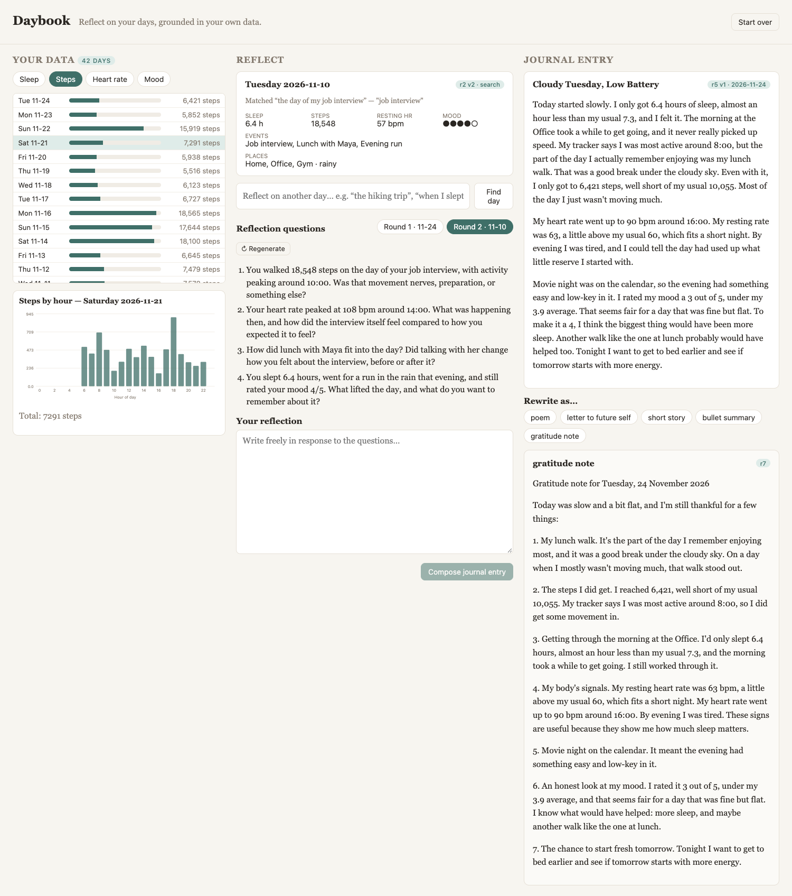

# Daybook (System X)

Reflective journaling grounded in personal data, built from `design.json`.
See `PLAN.md` for the interpretation and `NOTES.md` for every decision the design left open.

```bash
npm install
npm start            # http://localhost:3000  (PORT to change)
npm test             # deterministic tool steps
npm run seed         # regenerate data/records.json (42 synthetic days)
```

Model steps call the local Claude Code CLI (`claude -p --output-format json`, with `CLAUDECODE`
removed from the environment). To swap providers, replace `callModel()` in `server/llm.js`.
Optional env: `CLAUDE_BIN`, `CLAUDE_MODEL`, `MODEL_TIMEOUT_MS`.



## Design → code

| Process | Transformation | Code |
| --- | --- | --- |
| 1 | `[tool select]` r1* → r2_1 | `selectFocusRecord` in `server/tools.js`, `GET /api/focus`, `selectFocus` in `public/app.js` (runs on page load) |
| 1 | `[model generate]~` r1* + r2 → r3_1* | `generatePrompts` in `server/operations.js`, `POST /api/prompts` (runs on page load) |
| 1 | `[human generate]` → r4 | "Your reflection" textarea (`#response`) |
| 1 | `[model compose]~` r1* + r2 + r3* + r4 → r5 | `composeEntry`, `POST /api/compose`, "Compose journal entry" button |
| 2 | `[human specify]` → r6 | "Rewrite as…" style chips (`STYLES` in `server/operations.js`) |
| 2 | `[model compose]~` r2 + r4 + r5 + r6 → r7 | `restyleEntry`, `POST /api/restyle` |
| 3 | `[human specify]` → r8 | "Reflect on another day…" input (`#search-form`) |
| 3 | `[tool select]` r1* + r8 → r2_2 | `searchRecord` in `server/tools.js`, `POST /api/search` |
| 3 | `[model generate]~` r5 + r2_2 + r8 → r3_2* | `generatePrompts({record, query, entry})`, `POST /api/prompts` with `query` |
| 4 | `[human select]` → r9 | metric chips (`METRICS` in `server/tools.js`) |
| 4 | `[tool select]` r1* + r9 → r10* | `metricRecords`, `GET /api/metric/:metric` |
| 4 | `[human select]` → r11 | click/Enter on a row of the metric list |
| 4 | `[tool translate]` r11 → r12 | `chartSpec` (`GET /api/chart/:metric/:id`) + `renderChart` in `public/chart.js` |

Identifier names in code: r1 `records`, r2 `focus`, r3 `rounds[].prompts`, r4 `rounds[].response`,
r5 `entries`, r6 `style`, r7 `restyles`, r8 `query`, r9 `metric`, r10 `metricItems`, r11 `chosenId`, r12 `chart`.
